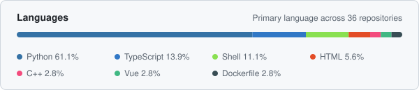

<picture>
  <source media="(prefers-color-scheme: dark)" srcset="header.svg"/>
  <source media="(prefers-color-scheme: light)" srcset="header-light.svg"/>
  
</picture>

  

 

Ingeniero industrial especializado en el diseño y despliegue de soluciones de inteligencia artificial generativa.

 

### Proyecto destacado

<a href="https://github.com/ivanvilarinom/loyola_horarios">
  <picture>
    <source media="(prefers-color-scheme: dark)" srcset="https://github-readme-stats.vercel.app/api/pin/?username=ivanvilarinom&repo=loyola_horarios&hide_border=true&bg_color=0d1117&title_color=e6edf3&text_color=8b949e&icon_color=58a6ff"/>
    
  </picture>
</a>
